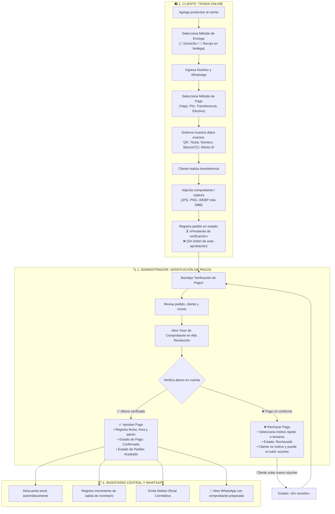

# 🏪 BodegaControl: Sistema Integral de Gestión, Tienda Online y Verificación de Pagos

Sistema web moderno y profesional que unifica la administración de una bodega física con una tienda virtual para clientes, compartiendo un **inventario central en tiempo real**, **módulo de verificación de pagos administrado**, **3 estados independientes de pedidos** y conexión automática con **WhatsApp** para el envío de comprobantes oficiales de pago.

---

## 🚀 Cómo Iniciar el Sistema

No requiere instalación de servidores ni configuraciones complejas:

1. Ingresa a la carpeta del proyecto:
   `C:\Users\silvi\.gemini\antigravity\scratch\bodegacontrol\`
2. Haz doble clic en el archivo **`index.html`** para abrirlo en cualquier navegador web moderno (Google Chrome, Microsoft Edge, Firefox, Safari).
3. **Cuentas y perfiles preconfigurados:**
   - 👑 **Administrador / Dueño:** Usuario `donpepe` | Contraseña `123`
   - 🧑‍💻 **Cajero:** Usuario `cajero1` | Contraseña `123`
   - 🛍️ **Cliente (Tienda Online):** Usuario `cliente` | Contraseña `123`
   - *Alternador Rápido:* Usa los botones de perfil en la pantalla de bienvenida o el botón **"Ver Tienda Online / Panel Personal"** en la barra superior.

---

## 🎯 Flujo del Proceso de Pago y Verificación



---

## 🌟 Funciones Principales

### 1. 🛡️ Modificación del Proceso de Pago del Cliente
- **Eliminación total de auto-aprobación:** El cliente **no tiene ningún botón ni funcionalidad** que le permita confirmar o aprobar por su cuenta que su pago fue realizado o validado.
- **Registro inicial seguro:** El pedido se registra con el estado de pago **«Pendiente de verificación»** y el estado de pedido en **«Pendiente»**.
- **Pantalla interactiva de seguimiento (`#modalClientOrderTracking`):** Permite al cliente consultar en vivo los 3 estados independientes de su pedido, ver la miniatura de su comprobante, y contactar a la bodega por WhatsApp.

### 2. 💳 Métodos de Pago Configurables y Visualización de Datos
El administrador gestiona los métodos en la sección **«Métodos de Pago»**:
- **🟣 Yape:** Código QR real de la bodega, nombre del titular, número de celular asociado e instrucciones.
- **🔵 Plin:** Código QR oficial, titular de la cuenta, número de celular e instrucciones.
- **🏦 Transferencia Bancaria:** Nombre del banco (BCP, BBVA, Interbank, etc.), nombre del titular, número de cuenta, código de cuenta interbancario (CCI) e instrucciones.
- **💵 Efectivo:** Instrucciones de pago contraentrega o en mostrador.
- **Monto exacto a pagar:** La tienda online calcula y destaca siempre el monto exacto (`S/ XX.XX`) que el cliente debe transferir.
- **Ocultamiento automático:** Si un método es desactivado por el administrador con el interruptor, no se muestra como opción disponible para el cliente en el checkout.

### 3. 🔍 Nueva Sección: Verificación de Pagos para el Administrador
Bandeja dedicada (`view-verificacion-pagos`) donde el dueño de la bodega audita los pagos:
- **Detalle completo:** Código de pedido, fecha y hora, datos del cliente, enlace directo a WhatsApp, lista de productos adquiridos, monto total, método de pago, miniatura del comprobante y estado actual.
- **Visor en pantalla completa (`#modalViewVoucher`):** Permite hacer clic en la miniatura para inspeccionar la captura de pago en alta resolución con sus metadatos (nombre de archivo, peso en KB/MB y fecha de carga).
- **✅ Botón «Aprobar Pago»:**
  1. Verifica que los fondos hayan ingresado en la cuenta bancaria.
  2. Cambia el estado del pago a **`Confirmado`**.
  3. Cambia el estado del pedido a **`Aceptado`**.
  4. Registra fecha/hora de verificación y el nombre del administrador.
  5. Descuenta automáticamente el stock del inventario central compartido.
  6. Registra la salida en el historial de movimientos de inventario.
  7. Genera la boleta oficial y prepara el comprobante para WhatsApp.
- **❌ Botón «Rechazar Pago» (`#modalRejectPayment`):**
  1. Despliega un modal para registrar el motivo (monto no coincide, comprobante ilegible, no recibido en cuenta, titular incorrecto, etc.).
  2. Cambia el estado del pago a **`Rechazado`**.
  3. Registra el motivo, fecha/hora y nombre del administrador.
  4. Muestra una alerta explicativa al cliente en su pantalla de seguimiento para que pueda adjuntar un nuevo comprobante corregido. Al subirlo, el estado pasa automáticamente a **«En revisión»**.

### 4. 🔀 Los 3 Estados Estrictamente Independientes
El sistema maneja tres ciclos de vida completamente independientes para cada orden:
1. **Estado del Pago:**
   - `Pendiente de verificación`
   - `En revisión` (cuando el cliente re-sube un comprobante corregido)
   - `Confirmado`
   - `Rechazado`
2. **Estado del Pedido:**
   - `Pendiente`
   - `Aceptado`
   - `En preparación`
   - `Listo para entregar`
   - `Completado`
   - `Cancelado`
3. **Estado de Entrega:**
   - `Pendiente`
   - `En camino`
   - `Entregado`

> 💡 **Regla clave:** Un pedido pagado no significa que esté entregado. El personal administra cada selector de manera independiente desde la tabla de pedidos online (`view-pedidos`).

### 5. 🛵 Métodos de Entrega
Al momento del checkout, el cliente elige:
- **🛵 Envío a Domicilio:** Requiere ingresar dirección exacta de entrega y referencias.
- **🏪 Recojo en Bodega:** Muestra la dirección del local físico de la bodega y los horarios de atención.

### 6. 📦 Historial «Mis Pedidos» para Clientes
- Acceso directo desde el botón **«📦 Mis Pedidos»** en la barra de navegación de la tienda online.
- Muestra el historial completo de pedidos del cliente con sus 3 estados independientes y acceso a la pantalla de seguimiento en un clic.

### 7. 📲 Envío de Boleta por WhatsApp
- Apertura automática de chat de WhatsApp con comprobante oficial estructurado:
  - Número de boleta correlativo (`B001-XXXX`).
  - Lista detallada de productos y cantidades.
  - Subtotal y total pagado.
  - Método de pago confirmado.
  - Mensaje de agradecimiento y datos de contacto de la bodega.

---

## 👥 Permisos por Rol

| Módulo / Funcionalidad | 👑 Administrador | 🧑‍💻 Cajero | 🛍️ Cliente |
| :--- | :---: | :---: | :---: |
| **Tienda Online (Catálogo & Carrito)** | ✅ | ✅ | ✅ |
| **Registro de Pedido Online** | ✅ | ✅ | ✅ |
| **Adjuntar / Reemplazar Comprobante** | ✅ | ✅ | ✅ |
| **Seguimiento de Pedido con 3 Estados** | ✅ | ✅ | ✅ |
| **Verificación de Pagos (Aprobar/Rechazar)** | ✅ | ❌ | ❌ |
| **Configuración de Métodos de Pago & QR** | ✅ | ❌ | ❌ |
| **Gestión de Inventario (Editar/Eliminar/Precios)** | ✅ | ❌ (Solo consulta) | ❌ |
| **Ventas Presenciales (Caja POS)** | ✅ | ✅ | ❌ |
| **Cambio de Estados de Pedido y Entrega** | ✅ | ✅ | ❌ |
| **Reportes Comerciales y Configuración** | ✅ | ❌ | ❌ |

---

## 📁 Estructura del Código Fuente

```
bodegacontrol/
├── index.html         # Vistas: Verificación de Pagos, Métodos de Pago, Pedidos, Modales
├── css/
│   └── styles.css     # Badges de 3 estados, visor de voucher, switch toggles, dropzones
├── js/
│   ├── data.js        # Schemas de métodos de pago, pedidos online, persistencia y migración
│   └── app.js         # Lógica de checkout sin auto-aprobación, aprobación/rechazo admin y tracking
└── README.md          # Documentación técnica y guía de usuario
```
